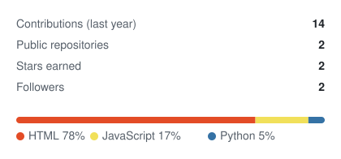

## Bartosz Koczewski

Developer from Białystok, Poland. I build small tools around AI coding assistants and work on side projects in my free time.

### Languages

Python · TypeScript · JavaScript · HTML · CSS

### Projects

**[claude-wrapped](https://github.com/Raxu14/claude-wrapped)** — your Claude Code and Codex usage stats as an animated, Wrapped-style recap. Runs locally, no login required.

### Stats

